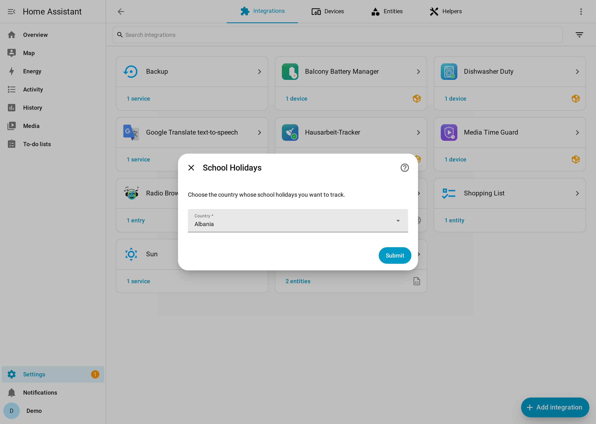
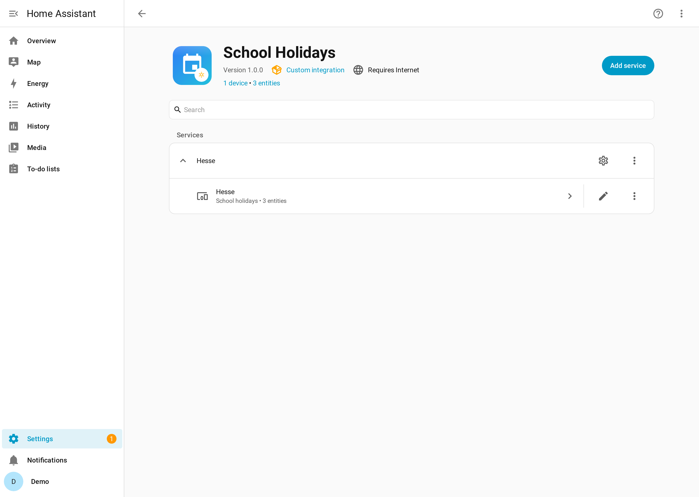
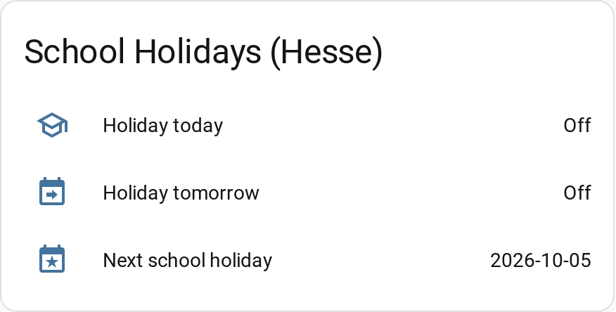

# 🎒 School Holidays

> A Home Assistant integration that tells you whether **today** or **tomorrow** is a school holiday for your country and region — and when the next break begins. Data comes from the free, official **[openholidaysapi.org](https://openholidaysapi.org)**, so it works for dozens of countries and their sub-regions without an API key.

[](https://github.com/hacs/integration)
[](https://github.com/Jo-Highness/school_holidays/actions/workflows/validate.yml)
[](https://github.com/Jo-Highness/school_holidays/actions/workflows/test.yml)
[](https://github.com/Jo-Highness/school_holidays/releases)
[](LICENSE)
[](https://www.home-assistant.io)

---

## Table of contents

- [Why this exists](#why-this-exists)
- [Screenshots](#screenshots)
- [Installation](#installation)
- [Configuration](#configuration)
- [Entities](#entities)
- [Automation examples](#automation-examples)
- [How it behaves](#how-it-behaves)
- [Troubleshooting / FAQ](#troubleshooting--faq)
- [Contributing](#contributing)
- [License](#license)
- [Credits](#credits)

---

## Why this exists

Plenty of home automations should simply behave differently on a school holiday: wake-up
lights and alarms, chores, screen-time limits, blinds, heating schedules. Home Assistant
has no built-in source for **school holidays**, and the school-holiday calendar differs by
region (in Germany, for example, every federal state has its own dates).

This integration fills that gap:

- It covers **arbitrary countries and their sub-regions** through
  [openholidaysapi.org](https://openholidaysapi.org) — a free, official open-data service
  that requires **no API key**.
- Setup is entirely through the UI. You pick your country and region from dropdowns that
  are populated live from the API — no ISO codes to memorise, no YAML, no REST/template
  scaffolding to maintain.

**How it differs from Workday / public-holiday integrations.** The built-in *Workday*
integration and typical public-holiday sources model **statutory public holidays and
working days**. School holidays are a different calendar: they are usually longer periods
(weeks, not single days), they vary by sub-region, and a day can be a normal working day
for adults while still being a school holiday. This integration models exactly that
school-holiday calendar per region.

## Screenshots

> Captured from a demo Home Assistant with fictional data.

**Config flow — pick country, then region**



**Entities on the device page**



**Example dashboard card**



## Installation

### HACS (recommended)

This integration is installed through [HACS](https://hacs.xyz/).

[](https://my.home-assistant.io/redirect/hacs_repository/?owner=Jo-Highness&repository=school_holidays&category=integration)

1. Click the button above (it opens HACS on this repository), then choose **Download**.
   If you prefer to do it manually: open **HACS → Integrations → ⋮ → Custom repositories**,
   add `https://github.com/Jo-Highness/school_holidays` with category **Integration**, then
   search for *School Holidays* and download it.
2. **Restart** Home Assistant.
3. Go to **Settings → Devices & Services → Add Integration**, search for **School Holidays**,
   and follow the steps below.

### Manual installation

1. Copy the folder `custom_components/school_holidays/` from this repository into your
   Home Assistant configuration directory, so you end up with
   `<config>/custom_components/school_holidays/`.
2. **Restart** Home Assistant.
3. Go to **Settings → Devices & Services → Add Integration**, and search for **School Holidays**.

## Configuration

Everything is configured in the UI — there is no YAML. During setup you pick a country and
(if the country has them) a region. After setup you can change how often the data is
refreshed from the integration's **Configure** button.

| Option | Where | Type | Default | Description |
| --- | --- | --- | --- | --- |
| **Country** | Config flow (step 1) | Dropdown, populated from the API | — | *Required.* The country whose school-holiday calendar you want. |
| **State / region** | Config flow (step 2) | Dropdown, populated from the API | — | *Required when the selected country has sub-regions.* This step is **skipped automatically** for countries that have none, and the whole country is configured instead. |
| **Update interval** | Options (**Configure**) | Number, 1–168 hours | `12` | How often the integration polls the API for fresh holiday data. |

The interface language (dropdown labels, entity names) follows your Home Assistant
language. Holiday **names** are requested in your Home Assistant language too, as far as
openholidaysapi.org provides them.

**Multiple regions.** You can add the integration more than once — one entry per
country/region. Each entry creates its own device (the device is named after the region,
with manufacturer *openholidaysapi.org*) and its own set of entities, so you can track
several federal states side by side.

## Entities

Each configured region provides the following entities. All use `has_entity_name`, so the
integration prefixes them with the device (region) name — the exact `entity_id` therefore
depends on your region.

| Entity | Type | `device_class` | Attributes | Example state |
| --- | --- | --- | --- | --- |
| **School holidays today** | `binary_sensor` | — | `holiday_name`, `start_date`, `end_date` | `on` while today falls inside a holiday period, otherwise `off` |
| **School holidays tomorrow** | `binary_sensor` | — | `holiday_name`, `start_date`, `end_date` | `on` while tomorrow falls inside a holiday period, otherwise `off` |
| **Next school holiday** | `sensor` | `date` | `holiday_name`, `start_date`, `end_date`, `days_until` | `2026-10-06` (the start date of the current or next break) |

Notes:

- The two binary sensors expose the attributes of the **period that is (or will be)
  active** on the relevant day.
- **Next school holiday** reports the **start date** of the current or upcoming break as a
  `date` state; `days_until` counts the days from today to that start. There is **no**
  `state_class` on this sensor.
- Icons: today `mdi:school-outline`, tomorrow `mdi:calendar-arrow-right`,
  next holiday `mdi:calendar-star`.

## Automation examples

The `entity_id`s below are examples for a region called *Hesse* — replace them with the
IDs of your own region (check **Settings → Devices & Services → Entities**).

### 1. Notify that there is no school tomorrow

```yaml
alias: No school tomorrow
trigger:
  - platform: state
    entity_id: binary_sensor.hesse_school_holidays_tomorrow
    to: "on"
action:
  - service: notify.mobile_app_phone
    data:
      title: "No school tomorrow 🎉"
      message: >-
        Tomorrow is a school holiday
        ({{ state_attr('binary_sensor.hesse_school_holidays_tomorrow', 'holiday_name') }}).
mode: single
```

### 2. Skip the school-morning alarm on holidays

```yaml
alias: School morning wake-up
trigger:
  - platform: time
    at: "06:45:00"
condition:
  # Only run on actual school days.
  - condition: state
    entity_id: binary_sensor.hesse_school_holidays_today
    state: "off"
action:
  - service: scene.turn_on
    target:
      entity_id: scene.school_wakeup
mode: single
```

### 3. Countdown to the next holiday

```yaml
alias: Announce holiday countdown
trigger:
  - platform: time
    at: "07:30:00"
condition:
  - condition: template
    value_template: >-
      {{ state_attr('sensor.hesse_next_school_holiday', 'days_until') | int(-1) == 7 }}
action:
  - service: notify.mobile_app_phone
    data:
      message: >-
        One week until
        {{ state_attr('sensor.hesse_next_school_holiday', 'holiday_name') }}!
mode: single
```

## How it behaves

- **Polling + local midnight rollover.** Holiday data is refreshed on the update interval
  you configure, but the *today* / *tomorrow* sensors are also **recomputed locally at
  midnight** without any network call — so they flip exactly at the day boundary even
  between polls.
- **Robust against API outages.** If a refresh fails because the API is briefly
  unreachable, the integration **keeps its last known data** rather than dropping the
  sensors to `unknown`, so your automations keep working.
- **Clean first setup.** If the **very first** setup fails because the API cannot be
  reached, the integration raises `ConfigEntryNotReady` and Home Assistant retries — it
  never creates empty or misleading sensors.

## Troubleshooting / FAQ

**The sensors are `unavailable` or the entry keeps retrying after adding it.**
This happens when openholidaysapi.org could not be reached during the first setup. Home
Assistant retries automatically; once the API is reachable the entry finishes loading. Check
that your Home Assistant host has outbound internet access to `openholidaysapi.org`.

**I picked the wrong country or region.**
Region and country are chosen during setup and are not editable afterwards. Remove the
integration entry (**Settings → Devices & Services → School Holidays → ⋮ → Delete**) and add
it again with the correct selection.

**Holiday names appear in the wrong language.**
Holiday names are requested in your Home Assistant language and depend on what
openholidaysapi.org publishes for that country. If a translation is not available upstream,
the API returns the name in whatever language it does have. The integration's own UI and
entity names are translated for English, German, Spanish and French.

**Enable debug logging** to see exactly what the integration requests and receives:

```yaml
logger:
  logs:
    custom_components.school_holidays: debug
```

Add this to `configuration.yaml`, restart Home Assistant, and check
**Settings → System → Logs**.

## Contributing

Contributions are welcome — bug reports, feature ideas, translations and pull requests. See
[`CONTRIBUTING.md`](CONTRIBUTING.md) for how to set up a development environment and run the
tests, and please open an issue on the
[issue tracker](https://github.com/Jo-Highness/school_holidays/issues) first for larger
changes.

## License

Released under the **MIT** license. See [`LICENSE`](LICENSE).

## Credits

- Holiday data © **[openholidaysapi.org](https://openholidaysapi.org)** (open data). This
  project is not affiliated with the API provider.
- Built for **[Home Assistant](https://www.home-assistant.io)**.
</content>
</invoke>
